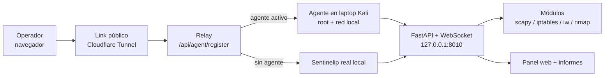
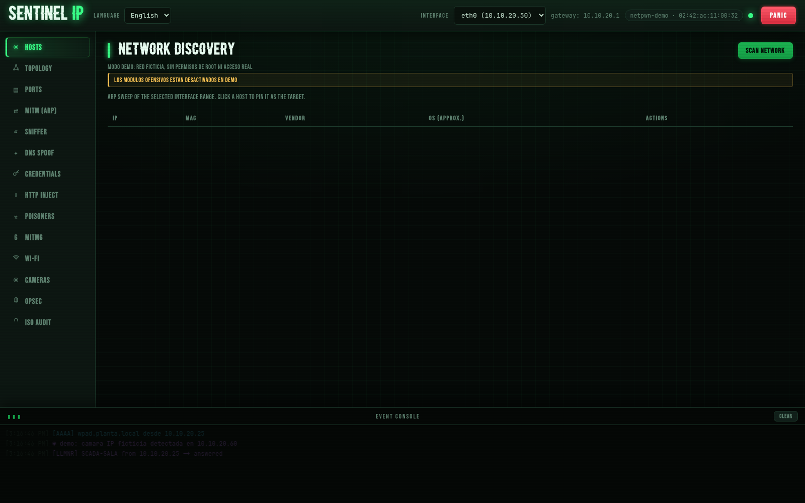
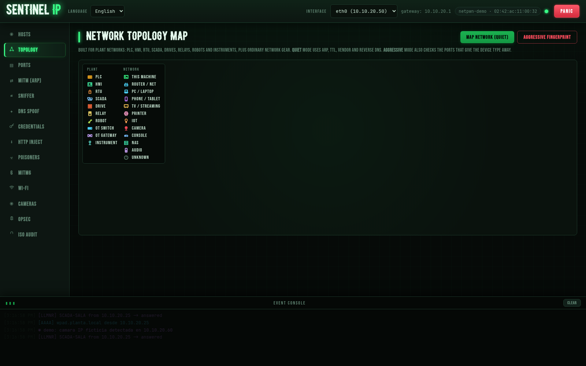
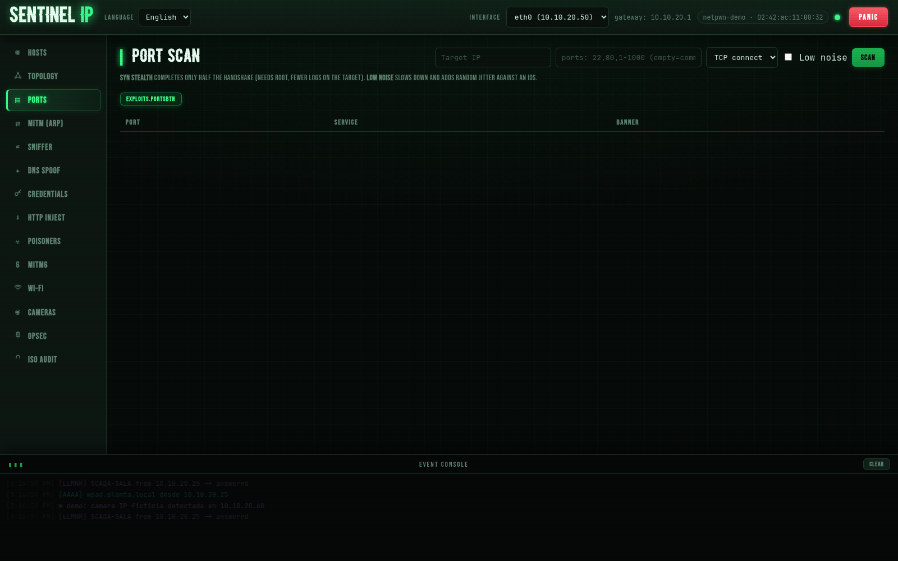
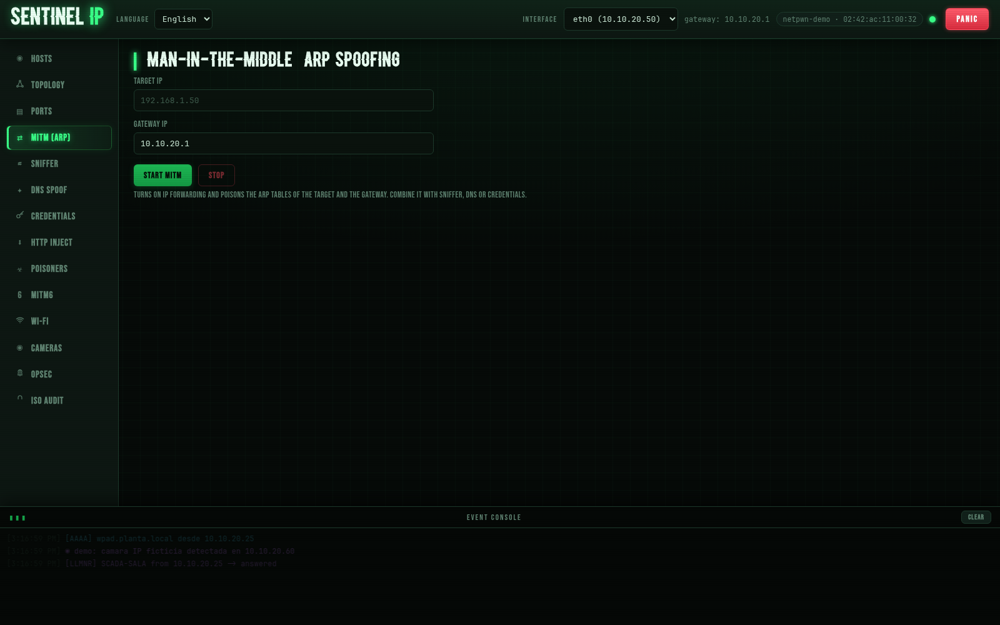
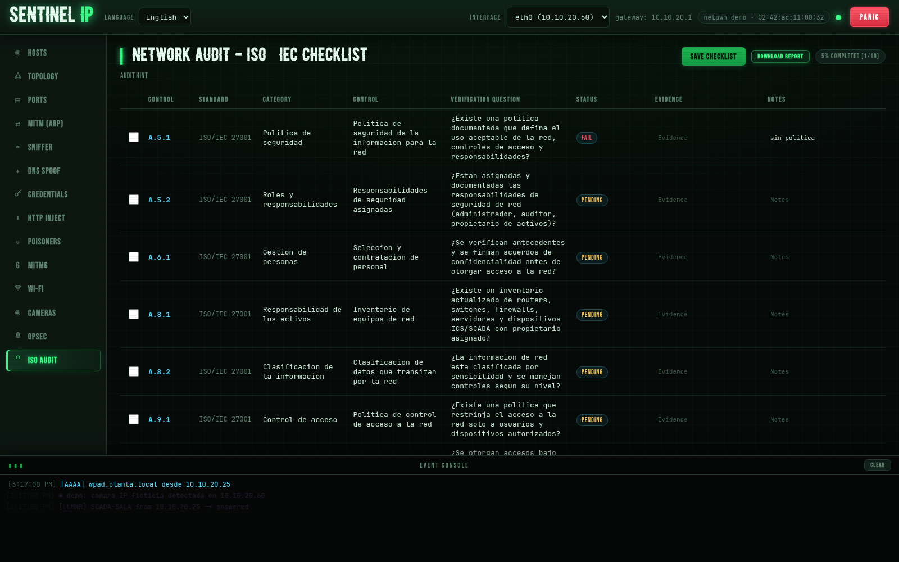
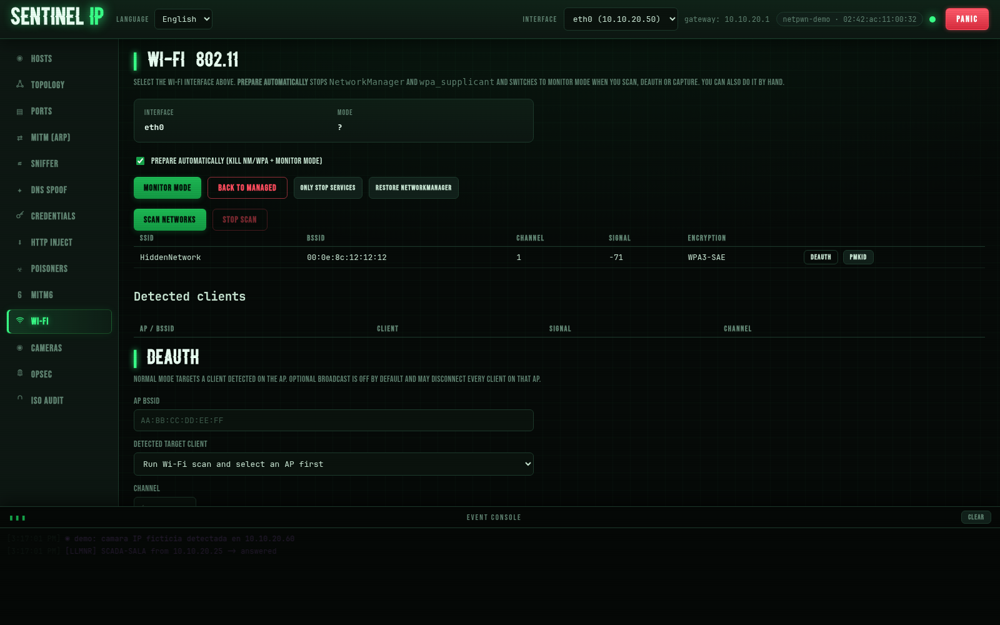
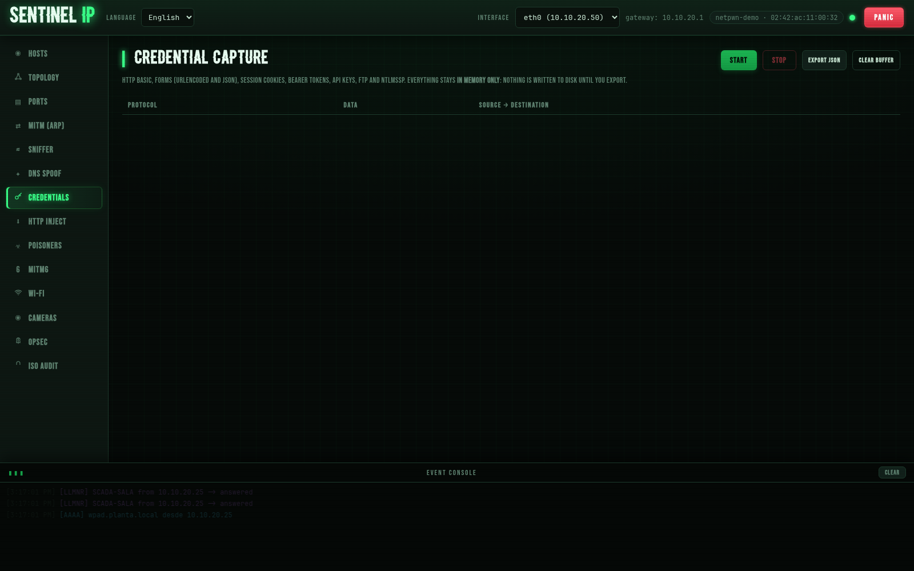
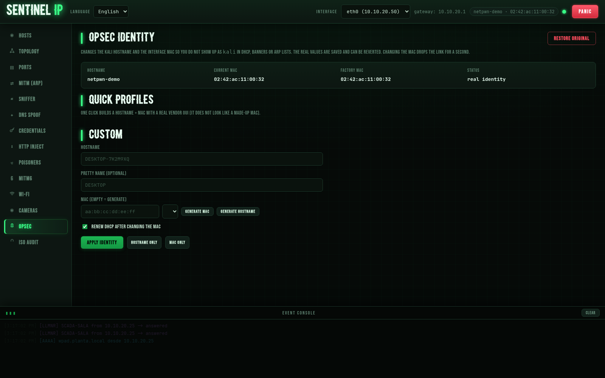

# Sentinelip

**Sentinelip** es una suite gráfica de auditoría y ataque de redes pensada para
cyber ranges, laboratorios ICS/SCADA y entrenamiento ofensivo/defensivo. Corre
en modo **real** (root, raw sockets, iptables, monitor WiFi) y expone un panel
web con eventos en vivo por WebSocket, evidencia, auditoría ISO/IEC 27001 e
IEC 62443, y un *kill switch* (PÁNICO) que revierte todos los cambios.

Repo: https://github.com/Leofiorett/sentinelip

> **ADVERTENCIA CRÍTICA**
> Esta herramienta incluye módulos ofensivos: ARP spoofing, MITM, DNS/WPAD
> poisoning, mitm6, inyección HTTP, captura de credenciales, deauth WiFi y
> explotación de cámaras IP. **Solo debe usarse en redes propias o bajo
> autorización explícita.** Uso no autorizado es ilegal en la mayoría de las
> jurisdicciones y puede suspender tu proveedor de hosting.

---

## Índice

- [Qué es](#qué-es)
- [Para qué sirve](#para-qué-sirve)
- [Por qué es importante](#por-qué-es-importante)
- [Arquitectura](#arquitectura)
- [Capacidades](#capacidades)
- [Galería de pantallas reales](#galería-de-pantallas-reales)
- [Modos: real y demo](#modos-real-y-demo)
- [Inicio rápido](#inicio-rápido)
- [Mapear la red donde estés (agente)](#mapear-la-red-donde-estés-agente)
- [Link público / relay](#link-público--relay)
- [Despliegue en VPS](#despliegue-en-vps)
- [Botón PÁNICO y limpieza](#botón-pánico-y-limpieza)
- [Seguridad y legal](#seguridad-y-legal)
- [Estructura del repositorio](#estructura-del-repositorio)

---

## Qué es

Sentinelip es una aplicación FastAPI + WebSocket con interfaz web que
centraliza un flujo de trabajo completo de *pentest* de red:

1. **Descubre** hosts y topología sin ruido o con fingerprinting agresivo.
2. **Enumera** puertos, servicios y sistemas operativos.
3. **Posiciona** al operador en medio de la comunicación (MITM/ARP, DNS,
   WPAD, mitm6).
4. **Captura** evidencia (credenciales, tráfico, handshakes WiFi).
5. **Audita** el cumplimiento ISO/IEC 27001:2022 Anexo A e IEC 62443.
6. **Genera** un informe HTML con mapa, hallazgos y evidencia.
7. **Restaura** el estado original con un solo botón.

Todo se controla desde una única UI oscura, en español/inglés, con consola de
eventos en tiempo real.

## Para qué sirve

- **Cyber ranges y entrenamiento**: ejército, ministerios, universidades y
  equipos blue/red/purple necesitan escenarios repetibles con herramientas
  gráficas que se puedan enseñar sin memorizar comandos.
- **Auditoría ICS/SCADA**: centrales eléctricas, plantas de agua y gasoductos
  usan Modbus/DNP3; Sentinelip mapea esos segmentos y verifica controles
  IEC 62443 sin detener la operación (modo pasivo).
- **Evaluación de WiFi corporativo**: detección de redes, modo monitor,
  captura de handshakes/PMKID y prueba de deauth en laboratorio.
- **Concienciación defensiva**: muestra a los alumnos *cómo se ve* un ataque
  desde el lado del atacante y qué rastro deja en el defensor (Suricata/Zeek).
- **Evidencia y reporte**: cada acción queda en la consola y el checklist ISO
  se exporta a un informe con capturas del mapa de topología.

## Por qué es importante

- **Reduce la barrera de entrada**: lo que antes requería combinar `nmap`,
  `scapy`, `bettercap`, `aircrack-ng` y hojas de cálculo, hoy es un panel único.
- **Operación segura**: el modo real guarda el estado previo (ip_forward, MAC,
  reglas iptables) y el botón **PÁNICO** revierte spoofers, reglas, reenvío e
  identidad OPSEC. En un aula eso evita "romper" el laboratorio.
- **Cobertura ICS**: pocas herramientas gráficas cubren simultáneamente red IT,
  WiFi, cámaras IP y controles IEC 62443.
- **Portátil y remota**: el agente permite que el mismo link sirva para mapear
  la red del lugar donde esté el operador, sin depender de un servidor fijo.
- **Formativa**: los eventos en vivo permiten explicar el *timing* de un ataque
  (descubrimiento → posicionamiento → captura → limpieza) paso a paso.

---

## Arquitectura



Componentes:

- `app/` — API FastAPI, bus de eventos, manager de módulos y UI estática.
- `sentinelip.py` — launcher; en Linux corre real como root (`--demo` opcional).
- `relay/relay.py` — decide a qué backend enviar al operador.
- `agent/agent.py` — levanta la app real en la laptop, abre su propio túnel y
  se registra cada 30 s.
- `Dockerfile` + `docker-compose.real.yml` — despliegue privilegiado en VPS.

## Capacidades

| Panel | Función |
|---|---|
| **Hosts** | Descubrimiento de hosts, vendor MAC, listado y exportación. |
| **Topología** | Mapa visual con modos *quiet* y *aggressive fingerprint*. |
| **Puertos** | Escaneo TCP, servicios, búsqueda de exploits por versión. |
| **MITM (ARP)** | Arp spoofing bidireccional con control de inicio/parada. |
| **Sniffer** | Captura de tráfico con filtros y volcado en vivo. |
| **DNS Spoof** | Respuesta falsa a consultas DNS selectivas. |
| **Credenciales** | Captura de credenciales en cleartext, buffer y export JSON. |
| **HTTP Inject** | Inyección de contenido en respuestas HTTP. |
| **Poisoners** | LLMNR/NBT-NS poisoning y WPAD. |
| **mitm6** | Ataque IPv6 DHCPv6 + DNS. |
| **Wi-Fi** | Escaneo, modo monitor, deauth, handshake y PMKID. |
| **Cámaras** | Descubrimiento ONVIF/RTSP y auditoría de cámaras IP. |
| **OPSEC** | Cambio de identidad / MAC y verificación de entorno. |
| **ISO Audit** | Checklist ISO 27001 + IEC 62443 con informe HTML. |

> Los módulos ofensivos se habilitan solo en modo real. En demo se reproduce
> una red ficticia con eventos simulados.

---

## Galería de pantallas reales

Capturas tomadas de la UI real (modo demo con red ficticia, para no exponer
datos de un laboratorio productivo).

**Panel principal — hosts y consola de eventos**



**Topología de red — mapa con hosts y enlaces**



**Escaneo de puertos y servicios**



**MITM / ARP spoofing**



**Auditoría ISO/IEC 27001 e IEC 62443**



**Módulo Wi-Fi (monitor, deauth, handshake)**



**Captura de credenciales**



**OPSEC / identidad**



---

## Modos: real y demo

| | Real | Demo |
|---|---|---|
| Root / raw sockets | Sí | No |
| iptables / ip_forward | Sí | No |
| WiFi monitor / deauth | Sí (hardware compatible) | No |
| Módulos ofensivos | Habilitados | Desactivados |
| Datos | Red real | Red ficticia con timeline |
| Dónde | Kali/Linux, VPS privilegiado | Cualquier SO, Windows/macOS/Linux |

Forzar demo: `python sentinelip.py --demo --port 8000`.

## Inicio rápido

```bash
python3 -m venv .venv
.venv/bin/pip install -r requirements-real.txt
sudo .venv/bin/python sentinelip.py --no-elevate --host 127.0.0.1 --port 8010
# abrir http://127.0.0.1:8010
```

Requisitos Linux: `iptables`, `iw`, `aircrack-ng`, `nmap`, `tcpdump` (los
instala el Dockerfile automáticamente).

## Mapear la red donde estés (agente)

Un servidor en internet **no puede ver la LAN del cliente**. Para eso existe el
agente: se ejecuta en tu laptop Kali con root, escanea la red local y registra
su URL en el relay.

```bash
curl -L https://harder-upgrading-coated-mice.trycloudflare.com/agent/download -o agente.tar.gz
tar xzf agente.tar.gz && cd sentinelip-agent
sudo ./install.sh
```

El instalador crea el venv, instala dependencias, arranca Sentinelip real en
`127.0.0.1:8010`, levanta un túnel Cloudflare propio y lo registra cada 30 s.
Además agrega `@reboot` al cron de root.

Después abrí el link público desde cualquier dispositivo: te redirige al
agente y mapeas **esa** red. Si apagás la laptop, el link vuelve al real de la
máquina original a los 5 minutos.

Para cambiar de PC: `sudo pkill -f sentinelip-agent/agent.py` en la anterior.

## Link público / relay

El relay expone:

- `GET /` — redirige al agente activo o al fallback real local.
- `POST /api/agent/register` — registro `{ "url": "https://..." }`.
- `GET /api/agent/url` — backend vigente.
- `DELETE /api/agent/register` — liberar el registro.
- `GET /agent/download` — descarga del agente Linux.

Variables:

- `SENTINELIP_URL` — link público del relay.
- `SENTINELIP_AGENT_TAR` — ruta del tarball servido en `/agent/download`.

## Despliegue en VPS

```bash
chmod +x deploy-real.sh
./deploy-real.sh usuario@IP dominio.com ruta/a/llave_privada
```

El contenedor corre con `network_mode: host`, `--privileged`, `NET_ADMIN`,
`NET_RAW`, `SYS_ADMIN`, `/dev` y `/sys` montados, y Caddy termina TLS en
80/443. Sin dominio se accede por `http://IP:8000`.

> Advertencia: `privileged` + host network equivale a root en el host. No lo
> compartas con otros servicios y usá solo targets autorizados.

## Botón PÁNICO y limpieza

El botón **PANIC** detiene spoofers, sniffer y poisoning; elimina reglas
iptables con comentario `netpwn`; restaura `ip_forward` y la MAC original; y
limpia la identidad OPSEC. Siempre presionarlo al terminar un ejercicio.

También: `POST /api/panic`.

## Seguridad y legal

- Solo laboratorios propios/autorizados. El proveedor del VPS puede suspender
  la cuenta por tráfico de ataque.
- No exponer credenciales ni evidencia sin cifrar; el modo demo existe para
  demostraciones públicas.
- WiFi monitor/deauth requiere placa compatible; en VPS típico no está
  disponible (el resto de los módulos IP sí).
- El link público no tiene autenticación por decisión del operador: cualquiera
  con la URL puede controlar el backend activo.

## Estructura del repositorio

```
app/                     API, módulos y UI
sentinelip.py            launcher real / demo
relay/relay.py           relay público + descarga del agente
agent/                   agente Linux con root
Dockerfile               imagen real con herramientas de red
docker-compose.real.yml  app + Caddy
deploy-real.sh           despliegue remoto en VPS
portable/                instaladores Windows/macOS/Linux (demo)
docs/screenshots/        capturas reales de la UI
requirements-real.txt    dependencias Python
```

---

**Sentinelip — uso oficial en cyber ranges y laboratorios autorizados.**
